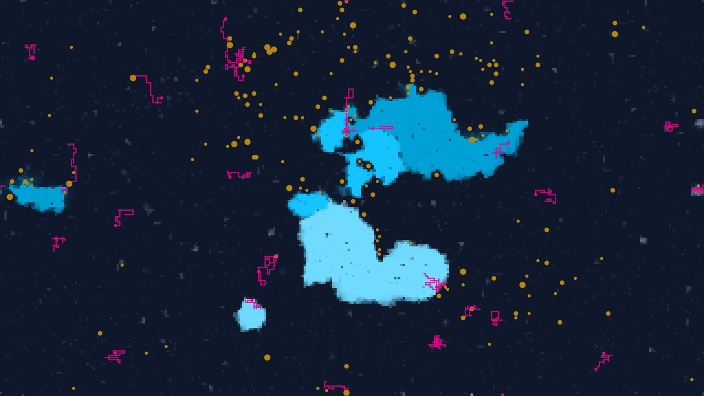
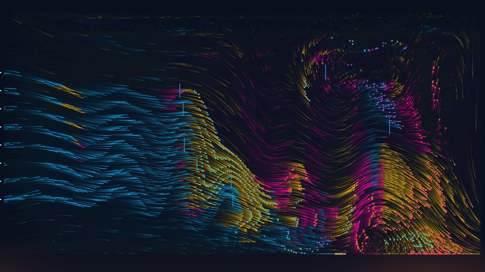
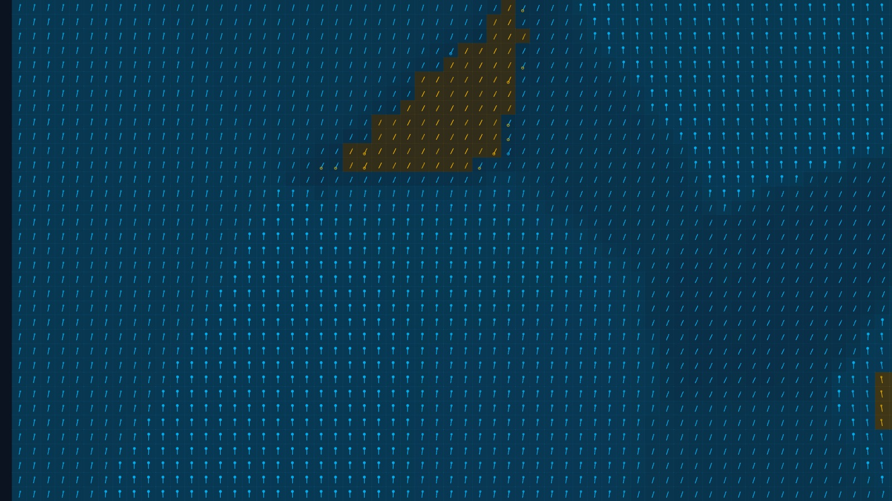
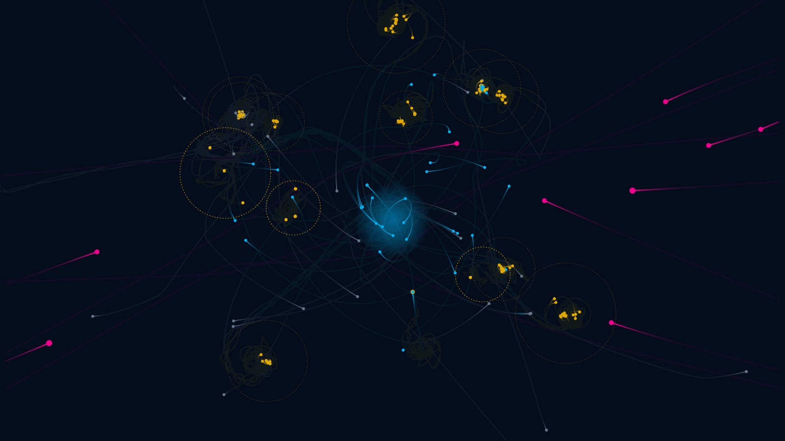
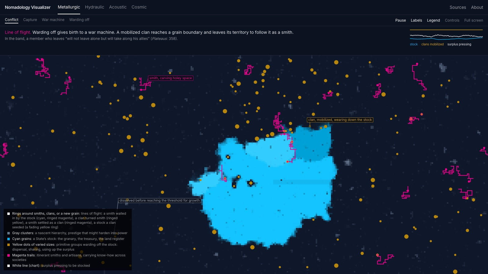

# Nomadology Visualizer

**[nomad-viz.vercel.app](https://nomad-viz.vercel.app)**

In *A Thousand Plateaus* (1980), Gilles Deleuze and Félix Guattari “define social formations by machinic processes and not by modes of production” (435), and they describe those processes in the language of physics: crystals and their nuclei, laminar and turbulent flow, resonance, the fall of bodies and the swerve. The Nomadology Visualizer takes them at their word. It stages three of their processes, **capture** (the State), the **war machine** (the nomads), and **warding off** (primitive societies), as the behavior of four materials, each run as a working physical simulation open to watching, varying, and taking to pieces.



## The four worlds

Each model asks what nomadology would look like in a world made of one material. The three processes are not three teams fighting over one prize. Each has its own movement and its own purpose, while they act on one another unequally: capture reaches for everything, the war machine strikes the State when it meets it, and warding off keeps a threshold at a distance. Lines of flight cross between them, so that a war machine can be captured and turned into an army, or a society that wards off the State can harden into one.

| | Capture | War machine | Warding off |
|---|---|---|---|
| **Metallurgic** (crystals) | a stock nucleates past a threshold and grows, drawing down the solution | smiths follow grain boundaries and carve holey space through the stock | clans settle on forming clusters and block them, then mobilize and wear the stock down |
| **Hydraulic** (a liquid) | the corvée carries labor in laminar lanes toward the State’s works | journeymen leave every channel as turbulence, and raids sweep down the conduit | households keep their labor in small convection cells, out of the corvée’s reach |
| **Acoustic** (beats) | one bell sets everyone’s hours: metronomes on a shared board fall into step | contagion passes the beat from neighbor to neighbor in waves, counted by no one | villages keep their own hours, spreading their tempi apart as the bell grows louder |
| **Cosmic** (gravity) | a capital city overcodes societies with its tides and catches companies in orbit as its army | companies ride open paths, raid the capital city, and ride on | societies on their own orbits tighten to keep the capital city’s tidal threshold outside them |

<table>
<tr>
<td></td>
<td></td>
<td></td>
</tr>
<tr>
<td align="center">Hydraulic</td>
<td align="center">Acoustic</td>
<td align="center">Cosmic</td>
</tr>
</table>

Across all four, the colors hold: cyan for capture, magenta for the war machine, yellow for warding off. Two further processes in *A Thousand Plateaus*, polarization (the town) and encompassment (ecumenical organizations), are not modeled yet, as each model’s sources explain.

## How to read a model



- **Conflict** is where every model opens: the three processes together, taking the lead in turn, with no permanent winner. **Capture**, **War machine**, and **Warding off** each isolate one process.
- **The narrator** above the canvas reports what is happening in social terms, names the physics in parentheses, and quotes the passage in *A Thousand Plateaus* it stages. The chart beside it tracks each process over time.
- **Labels** follow features on the canvas as they move. **Legend** explains the meaning of each color and mark.
- **Sources** opens the full apparatus for the current model (see below). **Controls** holds the physical parameters, which you can change while the model runs. **Full screen** shows the visualization alone.
- Every setting lives in the address bar, so any configuration can be linked or cited.

## Method

Deleuze and Guattari were not scientists, and their physics is often loose or borrowed secondhand (from Michel Serres on Lucretius, Gilbert Simondon on the mold, Pierre Boulez on musical time). So the visualizer neither corrects them silently nor illustrates them loosely. Each model’s **Sources** panel separates four things:

1. **What *A Thousand Plateaus* says**, quoted with page numbers from the Minnesota translation.
2. **What it borrows**, and from whom (cf. Clastres, Serres, Wittfogel, Virilio, Canetti, and others).
3. **The physics**, with the equations the simulation actually runs (nucleation theory, Navier-Stokes with buoyancy, the Kuramoto model, Newtonian gravity with tides and dynamical friction).
4. **Where they part ways**, both where the model departs from the book and where the book departs from physics.

Every quotation from *A Thousand Plateaus* in the code is checked against the text of the book by a script (`npm run check:atp`), and every model’s balance between its processes was measured by running it headless over thousands of frames (`npm run sim`). [docs/METHOD.md](docs/METHOD.md) describes how a model is built, and [docs/MODELS.md](docs/MODELS.md) gives each model’s physics and mapping in more detail.

## Run it locally

Requires Node.js 22 or later.

```sh
npm install
npm run dev            # http://localhost:3000
npm run build          # a static site in dist/, which any web host can serve
npm run sim -- cosmic  # run a model headless and summarize its behavior
```

[docs/ARCHITECTURE.md](docs/ARCHITECTURE.md) explains how the code is organized and how to add a model.

## Documentation

- [docs/MODELS.md](docs/MODELS.md): the four models, their physics, and their social reading
- [docs/METHOD.md](docs/METHOD.md): how a model is designed, tested, and written
- [docs/ARCHITECTURE.md](docs/ARCHITECTURE.md): the code, and how to add a model
- [docs/ROADMAP.md](docs/ROADMAP.md): what is planned next
- [CONTRIBUTING.md](CONTRIBUTING.md): how to report an error or propose a change
- [CHANGELOG.md](CHANGELOG.md): versions

## Cite it

See [CITATION.cff](CITATION.cff). GitHub’s “Cite this repository” button gives the same information in APA and BibTeX. To cite a particular configuration, cite its address, which records the model, the mode, and every setting.

## License

Code is licensed under the [Apache License 2.0](LICENSE), with the text and explanatory content under [CC BY 4.0](LICENSE-content). Quotations from *A Thousand Plateaus* and other works remain under their publishers’ copyright, so the text of the book is not included in this repository.

Made by Andrew Culp.
